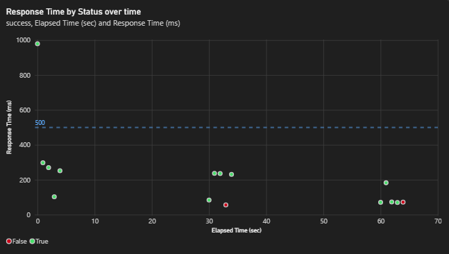
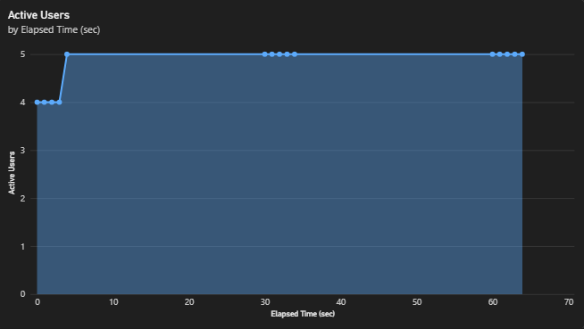

# Assurity Performance Testing Assignment

JMeter performance test suite for the Trade Me Sandbox Category Details endpoint (`GET /v1/Categories/{categoryId}/Details.json?catalogue=false`).

---

## 1. Project Layout

```text
assurity-perftest-assignment/
├── trademe_api_testplan.jmx               # Main test plan (workload, CSV config, TPH pacing)
├── fragments/
│   └── trademe_api_category.jmx           # Test fragment (HTTP sampler, Groovy assertion, Debug thread group)
├── data/
│   └── tmsandbox_category.csv             # Input Category IDs (6327 to 6336)
├── docs/
│   └── images/                            # Performance charts
├── jmeter-plugin/
│   └── jmeter-tph-switch-controller-1.0-SNAPSHOT.jar  # Custom TPH Switch Controller plugin
├── logs/
│   ├── trademe-api_1-min-test_20261120-123711.csv     # Raw JMeter results
│   └── trademe-api_category_log_20261120-123742.csv   # Extracted Promotion ID & Price output
├── report/                                # JMeter HTML Dashboard Report (report/index.html)
├── run_test.bat                           # Helper script to run non-GUI tests with a dynamic timestamp
└── README.md
```

### Design Notes
- **Main plan + fragment split:** `trademe_api_testplan.jmx` handles thread counts, ramp-up, duration, CSV loading, and throughput pacing. `fragments/trademe_api_category.jmx` contains the HTTP request, Groovy assertion, and a standalone `Debug` thread group for single-thread GUI checks.
- **Centralised data server placeholder:** The fragment includes a disabled `DATASOURCE (Placeholder)` controller showing how test data can be pulled from a central data service (`${host_central_data}:3000/api/search`) in distributed runs. It is disabled here so the script runs locally against `data/tmsandbox_category.csv` with no extra setup.
- **TPH Switch Controller:** Uses the bundled `TphSwitchController` plugin (`jmeter-plugin/jmeter-tph-switch-controller-1.0-SNAPSHOT.jar`) to pace child controller execution to the configured transactions-per-hour (`tph_api_category`) target.
- **Groovy `JSR223Assertion`:** Checks HTTP `200`, parses the JSON payload, validates `CategoryId` against `${param_category_id}`, checks `"CanRelist": true`, and appends `Category ID,Name,Path,Promotion ID,Price` for all promotions on passing requests to `logs/trademe_api_category_log_<TIMESTAMP>.csv` (synchronized across threads; skipped in `Debug`).

---

## 2. Prerequisites

- **Apache JMeter:** `5.6.3`
- **Java:** JDK `8`, `11`, `17`, or `21` (LTS). JMeter 5.6.3's Groovy 3 runtime throws `Unsupported class file major version 69` on Java 25+, so make sure `JAVA_HOME` points to JDK 21 or earlier.
- **Custom Plugin:** Copy `jmeter-plugin/jmeter-tph-switch-controller-1.0-SNAPSHOT.jar` into `<JMETER_HOME>\lib\ext\` before opening or running the test plan.

---

## 3. Running the Test (Non-GUI)

Use `run_test.bat` from the repository root. It generates a `yyyyMMdd_HHmmss` timestamp, clears the previous `report/` folder, and writes the raw CSV results to `logs/`:

```bat
run_test.bat
```

Or run JMeter directly:

```powershell
jmeter -n -t trademe_api_testplan.jmx -l logs\trademe_api_performance_test_results_<TIMESTAMP>.csv -e -o report
```

### Overriding Parameters via CLI (`-J`)

Both `run_test.bat` and `jmeter` accept `-J` overrides for all execution parameters:

| Parameter | Default | Notes |
| :--- | :--- | :--- |
| `users_api_category` | `5` | Half of the 10 Category IDs in `data/tmsandbox_category.csv` (NFR-01) |
| `rampup_api_category` | `5` | 1 VUser per second for 5 threads (NFR-02) |
| `duration_api_category` | `65` | 5s ramp-up + 60s steady state (NFR-03) |
| `tph_api_category` | `600` | Target throughput per hour (`600` TPH = 10 calls/min) (NFR-03) |
| `host_tmsandbox` | `api.tmsandbox.co.nz` | Target host |
| `scheme_tmsandbox` | `https` | Protocol |

Example with custom parameters:

```bat
run_test.bat -Jusers_api_category=10 -Jrampup_api_category=10 -Jduration_api_category=120 -Jtph_api_category=1200
```

---

## 4. Assumptions

1. **Ramp-up + steady state:** JMeter's `ThreadGroup.duration` includes `ramp_time`, so `duration_api_category` defaults to `65` seconds (`5s` ramp-up followed by `60s` steady state).
2. **CSV extraction on pass only:** Promotion rows are written to `logs/trademe_api_category_log_*.csv` only when all assertions pass. Failed calls are still logged in `logs/trademe_api_performance_test_results_*.csv` with their failure message.

---

## 5. Performance Test Report

### Purpose
Verify functional correctness and response time behaviour of the Trade Me Sandbox Category Details API across Category IDs `6327–6336` under the target 5-VUser load profile.

### Test Details

| Field | Value |
| :--- | :--- |
| **Test Name** | TradeMe API Test Plan (`trademe_api_testplan.jmx`) |
| **Environment** | TM Sandbox - `api.tmsandbox.co.nz` |
| **Test Started** | `2026-11-20 12:37:42 NZDT` |
| **Test Ended** | `2026-11-20 12:38:47 NZDT` |
| **VUsers / Ramp-Up** | `5` Threads, `5s` ramp-up (`1` VUser/sec) |
| **Test Duration** | `65s` (`5s` ramp-up + `60s` steady state) |
| **Target Throughput** | `600` TPH (`10` requests/min) |

### NFR Summary

| NFR | Requirement | Result | Status |
| :--- | :--- | :--- | :--- |
| **NFR-01** | VUsers = half the Category IDs (`5`) | `5` Threads configured | Pass |
| **NFR-02** | Ramp-up at 1 VUser/sec | `5s` ramp-up for `5` Threads | Pass |
| **NFR-03** | 10 API calls in 1-minute steady state | `15` total calls over `65s` (see notes below) | Pass |
| **NFR-04** | 90% of responses within `500 ms` | 90th percentile = `570.8 ms` (Median: `183 ms`) | Fail (1 cold-start call) |

### Local Run Metrics (`Category - HTTP Request`)
Raw data: [logs/trademe-api_1-min-test_20261120-123711.csv](logs/trademe-api_1-min-test_20261120-123711.csv)

| Metric | Value |
| :--- | :--- |
| Samples | `15` |
| Passed / Failed | `13` Passed / `2` Failed (`13.33%` error rate) |
| Min | `56 ms` |
| Median (50th) | `183 ms` |
| Mean | `214.4 ms` |
| 90th Percentile | `570.8 ms` |
| Max | `980 ms` |
| Throughput | `0.235 req/s` (`~14.1 req/min`) |
| Extracted CSV | [logs/trademe-api_category_log_20261120-123742.csv](logs/trademe-api_category_log_20261120-123742.csv) (`53` lines: `1` header + `52` promotion rows) |

### Observations

1. **90th Percentile (`570.8 ms` vs `500 ms`):**
   - `14` out of `15` requests completed between `56 ms` and `298 ms`, well below `500 ms`.
   - Only the very first request (`980 ms`) exceeded `500 ms`, due to `737 ms` of initial TCP/TLS connect time. With only 15 total samples, that single cold-start connection pulled the 90th percentile over the threshold to `570.8 ms`.

2. **Category `6331` Assertion Failures (`2 / 15`):**
   - Both failures were on Category ID `6331` with `Assertion Failed: 'CanRelist' value is not true for 6331`.
   - `https://api.tmsandbox.co.nz/v1/Categories/6331/Details.json?catalogue=false` returns HTTP `200` with `"CanRelist": false`, which the Groovy assertion flagged as expected.

3. **Request Count Over 65s (`15` calls):**
   - With 5 VUsers and `tph_api_category=600` (each VUser paced at 2 calls/min = 30s interval), the 5 threads fired at `t ≈ 0–4s`, `t ≈ 30–34s`, and `t ≈ 60–64s` (just before the 65s cutoff), producing `15` total calls (`10` in the first 60s).

### Charts
#### Response Times vs 500ms SLA over time

- Only the first request (`980 ms` at `t = 0s`) crossed the `500 ms` SLA line due to initial TCP/TLS connect time (`737 ms`).
- The remaining `14` requests stayed well below `500 ms` (`56–298 ms`), arriving in three 5-call bursts (`t = 0–4s`, `30–34s`, and `60–64s`).
- Both failed (`False`) points at `t ≈ 32s` and `t ≈ 64s` are Category `6331`, which returns `"CanRelist": false`.

#### Active Users

- Ramps up to `5` active threads over the first `5` seconds (`1` VUser/sec) and holds steady at `5` VUsers for the rest of the `65s` run.

*Note: Charts above were generated in Power BI using [logs/trademe-api_1-min-test_20261120-123711.csv](logs/trademe-api_1-min-test_20261120-123711.csv).*
